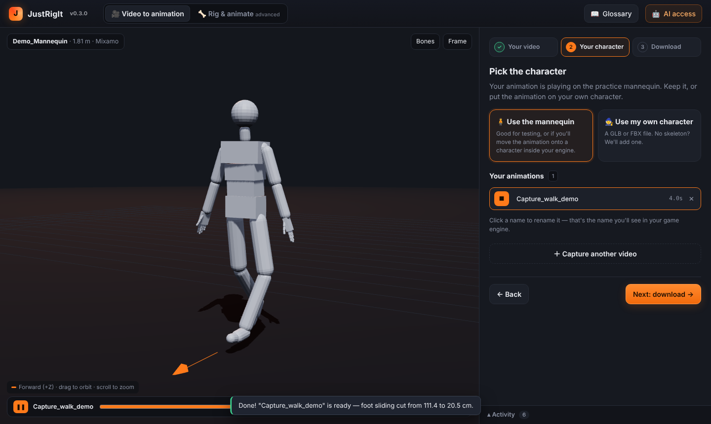
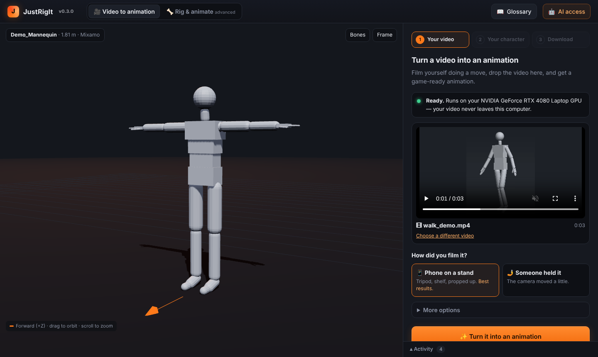
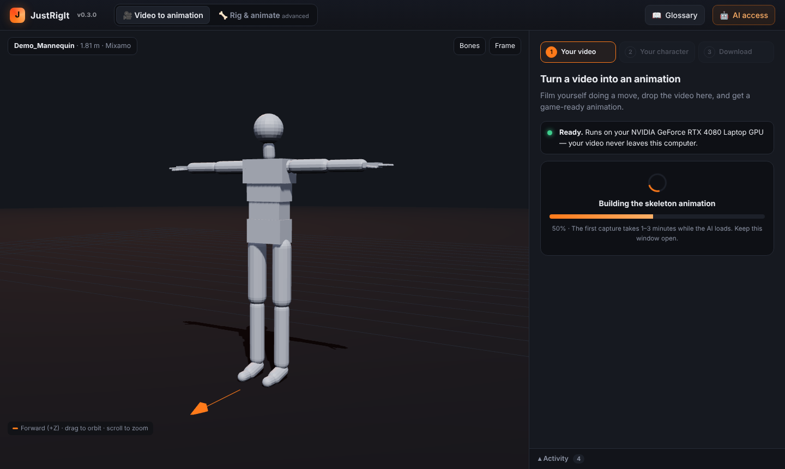
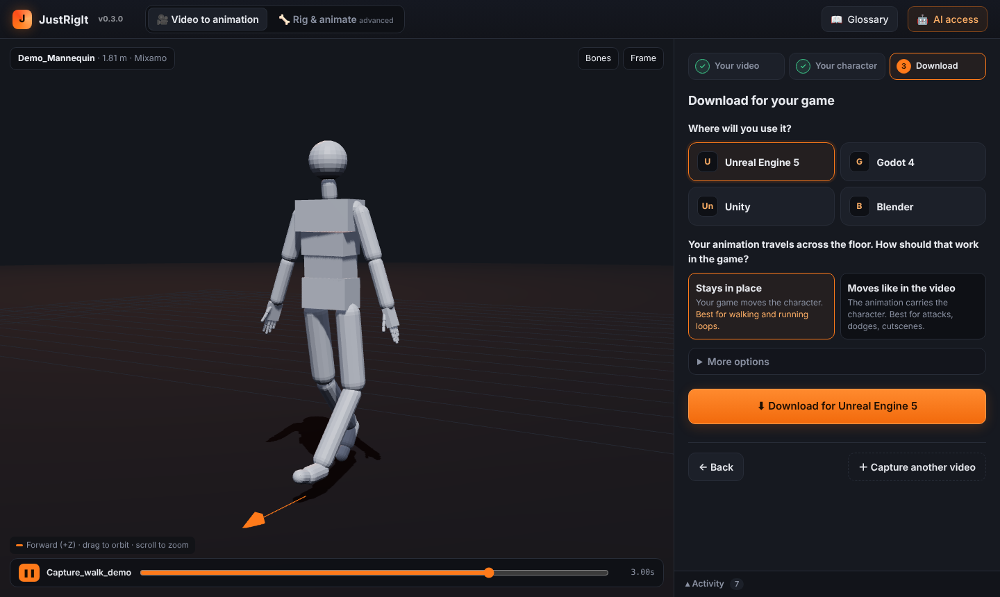
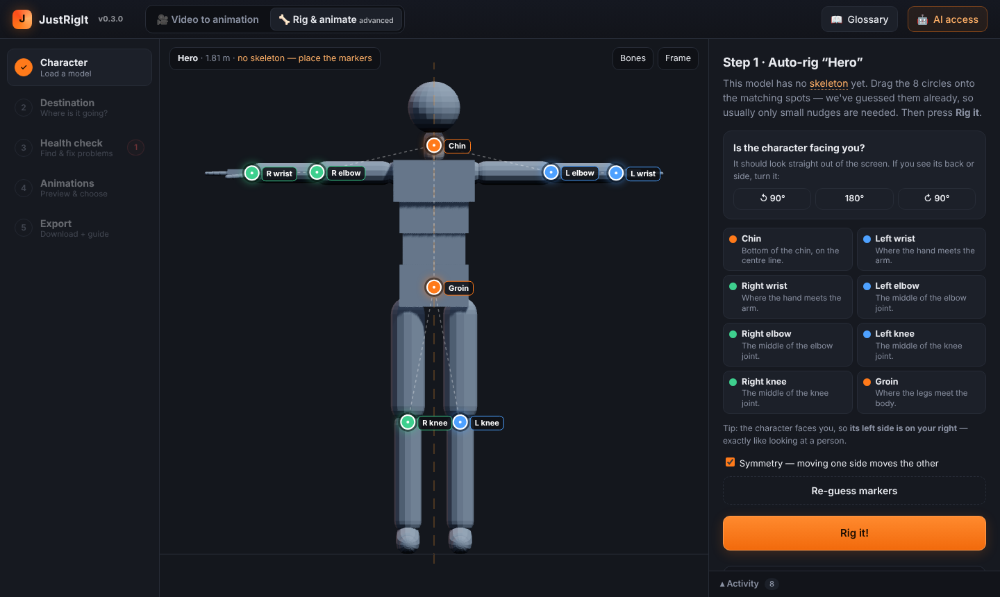
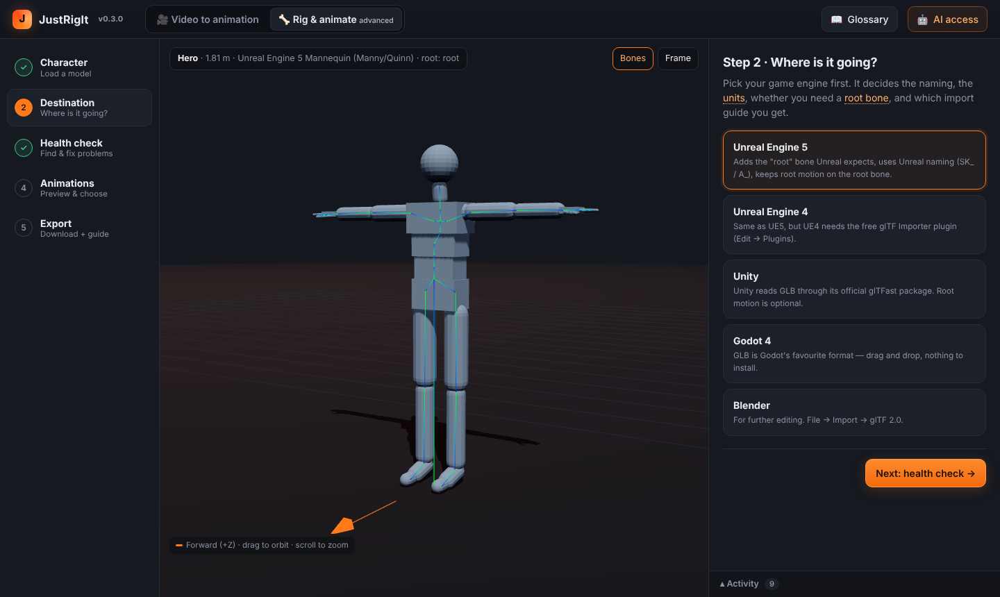
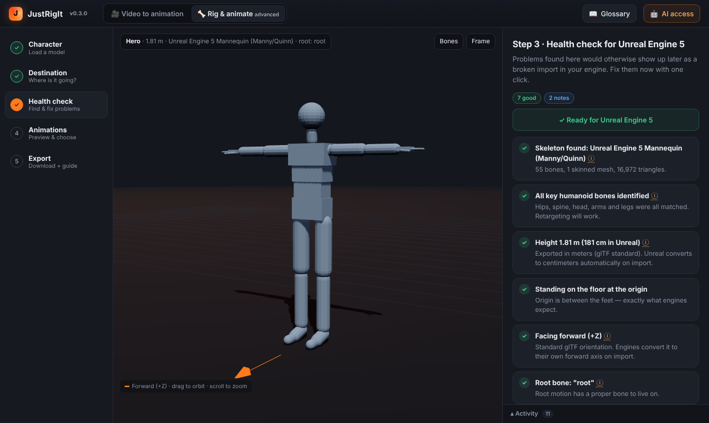
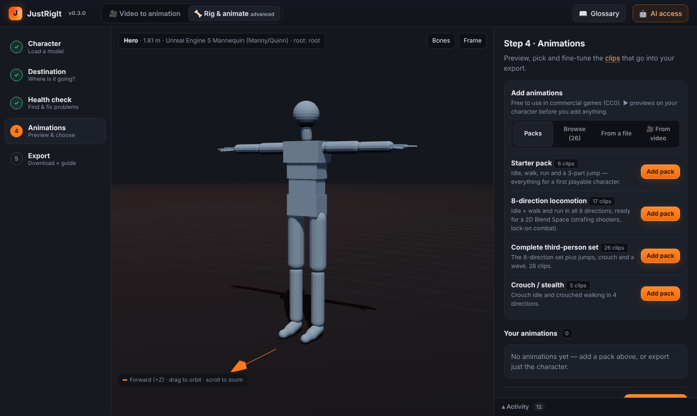
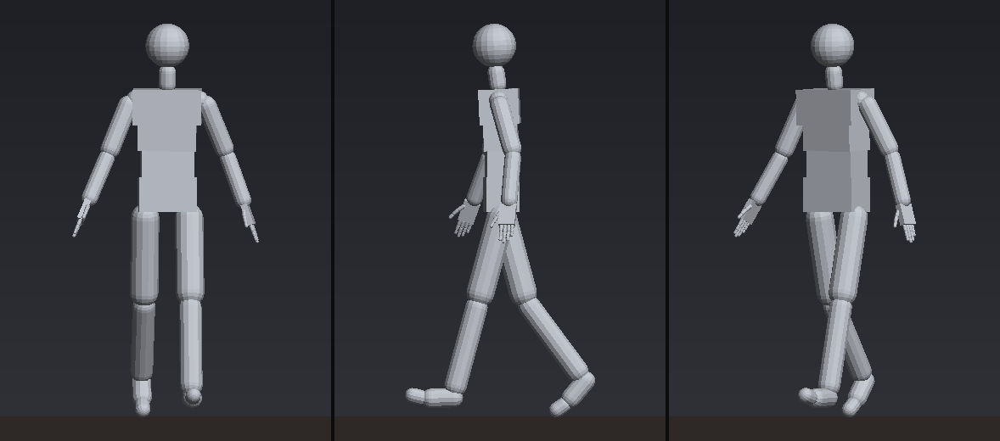
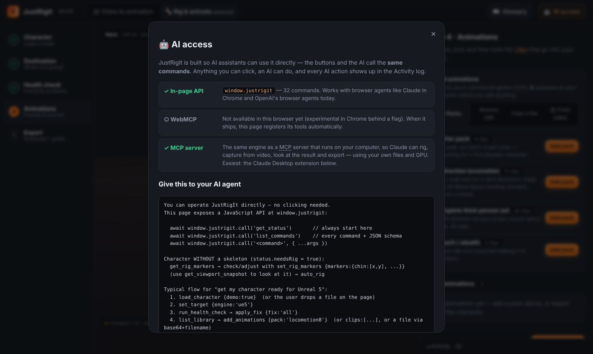

# JustRigIt

**Auto-rig, motion-capture from video and export game-ready characters for Unreal, Unity, Godot and Blender, locally.**

Film yourself doing a move on your phone, drop the video in, and get that motion on your character: rigged, cleaned
up, feet planted, and named the way your game engine expects. Everything runs on your own computer and GPU.
No accounts, no uploads, no subscription. JustRigIt is free software, and it stays free ([License](#license)).

<b><a href="https://github.com/SuddleMercury/justrigit/releases">⬇ Download the latest release</a></b>
 · <a href="#how-it-works">How it works</a> · <a href="#everything-it-can-do">Features</a>
 · <a href="#let-claude-do-it-for-you">Use it with Claude</a>
 · <a href="#contributing">Contribute</a>

## The problem
Getting a character to *move* in a game is where most solo developers and small teams get stuck:

- **Motion capture is expensive.** Mocap suits and studios cost thousands. Cloud video-mocap services charge
  monthly subscriptions or per-minute credits, and you have to upload your footage to someone else's servers.
- **Free animation libraries only go so far.** You get the moves someone else recorded, on their skeleton, behind
  their account and terms. The moment you need *your* move (a specific attack, a dance, an emote), you're stuck.
- **Rigging is a skill of its own.** A character fresh out of a sculpting tool or an AI generator has no skeleton.
  Rigging it by hand in Blender takes hours and plenty of tutorials.
- **Every engine wants something different.** Unreal expects `pelvis` and `thigh_l`, Godot expects `Hips` and
  `LeftUpperLeg`, Mixamo uses `mixamorig:Hips`. Get the names, scale, root bone or facing wrong and the import
  breaks: characters lying on their side, 100× too big, sliding feet, animations that won't retarget.
- **Beginners get buried in jargon** before they ever see their character move.

JustRigIt puts all of that into one free tool that runs on your own PC, in plain language, step by step.

## How it works
**1. Drop in a video.** Film yourself on a phone (propped up is best), whole body in view. Up to 60 seconds per clip.

**2. The AI turns it into motion, on your GPU.** NVIDIA's GEM-X model tracks your whole body *including fingers*
and how you move through the room. JustRigIt then cleans the motion up: finds the floor, faces it forward, smooths
the jitter and **locks planted feet** so they don't slide. Your video never leaves your computer.

**3. Put it on a character.** Use the built-in practice mannequin, or drop in your own character (GLB/GLTF/FBX).
No skeleton? JustRigIt adds one. Rename your clips here: that's the name you'll see in your engine.

**4. Download for your engine.** Pick Unreal Engine 5, Godot 4, Unity or Blender, and choose whether the animation
"stays in place" (for walk and run loops your game moves) or "moves like in the video" (root motion, for attacks and
dodges). You get a zip with the character, the animations, and an import guide written for those exact files.

## Everything it can do
### 🎥 Motion capture from video
- **Body, fingers and world motion** from one ordinary video ([NVIDIA GEM-X](https://github.com/NVlabs/GEM-X), runs
  locally on NVIDIA RTX GPUs).
- **Clean-up built in:** floor detection, gravity alignment, forward facing, start at the origin, zero-lag smoothing.
- **Foot locking:** detects when each foot is planted and pins it with IK (inverse kinematics), so feet don't skate.
- Phone on a stand or handheld; trim long videos with a start time and length; capture several moves and keep them all.

### 🦴 Auto-rigging, fingers included
Drop in a character with no skeleton. JustRigIt guesses 8 markers (chin, wrists, elbows, knees, groin); you nudge
them if needed and press **Rig it**. You get a 55-bone, Unreal-Mannequin-style skeleton **with fingers and thumbs**,
and skin weights calculated automatically (heat diffusion), in a couple of seconds.

| Place the markers | Rigged and recognised as an Unreal Mannequin |
|---|---|
|  |  |

### 🩺 Health check with one-click fixes
Catches the problems that would otherwise turn into a broken import, *before* you export: wrong scale or units,
character floating or sunk into the floor, facing the wrong way, missing root bone, duplicate bones. Each issue is
explained in plain language, with a **Fix** button.

### 🏃 Animation library and retargeting
- **26 built-in animations**, free for commercial use: idle, walk and run in 8 directions, jumps, crouch, wave.
  They come in packs, like "8-direction locomotion" ready for an Unreal Blend Space.
- **Bring your own animations:** drop any rigged animation file (Mixamo, Quaternius, Unreal, Blender exports) and
  it's **retargeted** onto your character, fingers included when both skeletons have them.
- Preview everything on *your* character before adding it. In-place or root motion per clip.

### 🎮 Exports that just import
- **Engine-standard bone names, automatically:** Unreal Mannequin (`pelvis`, `thigh_l`, `index_01_l` …),
  Godot SkeletonProfileHumanoid (`Hips`, `LeftUpperLeg`, `LeftIndexProximal` …) or Mixamo (`mixamorig:Hips` …).
  The engine maps the skeleton for you.
- **GLB files** (the open glTF standard) that Unreal 5 and Godot 4 import natively; Unity via the free glTFast package.
- **An import guide for your exact files**, including a full Unreal Blueprint walkthrough for an 8-direction Blend
  Space, written for beginners.
- A replayable **recipe**, so you can redo the same steps on another character.

### 🤖 Let Claude do it for you
JustRigIt is built so AI assistants can operate it: every button is also a command. Install the **Claude Desktop
extension** (`JustRigIt.mcpb` from the releases) and just ask:

> *"Find my latest video, turn it into an animation on my alien character and export it for Unreal."*

Claude finds the files, rigs the character, runs the capture (starting the engine if needed), **looks at the result**
to check it, and exports to your `Documents\JustRigIt Exports` folder. It all happens on your computer.

| What Claude sees when it checks its work | Built-in AI access |
|---|---|
|  |  |

### 💬 Made for beginners
Plain-language steps, a glossary of every term (skeleton, root motion, retargeting, IK…) with *why it matters*
and *when you need it*, and sensible defaults everywhere. Advanced options are there when you want them.

## Requirements
- **The app** (rigging, library, retargeting, export): Windows, macOS or Linux, any modern browser
  (Edge, Chrome, Firefox). `dist/justrigit.html` is a single self-contained file.
- **Video motion capture:** Windows 10/11, NVIDIA RTX GPU with 8 GB+ VRAM (12 GB recommended), about 15 GB of disk
  for the AI model. `Install-Capture.bat` sets everything up (Python, PyTorch, ffmpeg, the model) in one go.
- **Claude extension:** [Claude Desktop](https://claude.ai/download). Nothing else to install.

## Download and quick start (Windows)
1. Download **`justrigit-vX.Y.Z.zip`** from **[Releases](https://github.com/SuddleMercury/justrigit/releases)**
   and unzip it.
2. Double-click **`Install-Capture.bat`** once, for video capture (`Install-Capture.bat -DemoOnly` sets up a
   1-minute practice version first).
3. Double-click **`Start-JustRigIt.bat`**. JustRigIt opens in its own window, with **Video to animation** as the
   home screen. Rigging, the animation library and health checks are under **Rig & animate (advanced)**.
   The capture engine runs hidden and stops by itself when you close the window
   (log: `%LOCALAPPDATA%\JustRigIt\capture\engine.log`).
4. *(Optional)* Download **`JustRigIt.mcpb`** and double-click it to add JustRigIt to Claude Desktop.

## Roadmap & help wanted
JustRigIt is open to contributions, and these are the big things it could use help with. Comment on (or open) an
issue before starting something large.

- **FBX export**, for engines and tools that don't read GLB well.
- **Two or more people in one video** (fights, dances, partner moves).
- **Face and lip-sync capture** from the same video.
- **Video capture on Linux and macOS** (the engine is Python; the installer is Windows-only today).
- **Non-human rigs**: quadrupeds, creatures with tails or wings.
- **More built-in animations** (all must be free for commercial use).
- **Better auto-rigging** for A-poses, loose clothing, and fists or mitten hands.
- **Import guides and testing** for more engine versions (Unreal 5.x, Godot 4.x, Unity + glTFast).
- **Translations** of the interface and guides.

## Contributing
Bug reports, ideas, tests with your own characters and engines, docs and code are all welcome.
See **[CONTRIBUTING.md](CONTRIBUTING.md)** for setup (5 minutes, no GPU needed), tests and how to send a change.
Every pull request is checked automatically.

## Run the web app
- Open `dist/justrigit.html` in Chrome/Edge/Firefox — it's one self-contained file.
- To host it: upload that file to any web server as `index.html`. No backend needed.

## Let Claude use JustRigIt (MCP)
JustRigIt runs on your computer, and AI assistants drive it through MCP (Model Context Protocol). The AI calls
JustRigIt's tools: load, auto-rig, capture from video, add animations, look at the result, export. Your files and GPU
stay local.

**Easiest: Claude Desktop extension (no Node.js needed).** Double-click `dist/JustRigIt.mcpb` (or Claude Desktop →
Settings → Extensions → Install Extension…), choose an export folder and click Install. Claude Desktop runs it with
its own built-in Node.js. Claude sessions that are linked to this computer through the desktop app can use it too.

| Other clients | Setup (needs Node.js 18+ and `npm install` in this folder) |
|---|---|
| Claude Desktop (manual) | Settings → Developer → Edit Config: `{"mcpServers":{"justrigit":{"command":"node","args":["C:/path/to/justrigit/src/node/mcp-server.mjs"]}}}` |
| Claude Code | `claude mcp add justrigit -- node /path/to/justrigit/src/node/mcp-server.mjs` |
| ChatGPT (developer mode), claude.ai custom connector, OpenAI Responses API | Run remotely: `npm run mcp:http -- --public-url https://rig.your-domain.com`, reverse-proxy HTTPS to port 8787, connect to `https://rig.your-domain.com/mcp` |

What the local server does for an AI:
- **Finds your files.** `find_files` searches Desktop, Downloads, Videos, Documents and Pictures (OneDrive too).
  Paths may be typed loosely: quotes, `~`, `%USERPROFILE%`, `Desktop/clip.mp4`. A wrong path gets a "did you mean…".
- **Starts the capture engine itself** if it's installed but not running (no window; it stops after 30 min idle).
- **Long captures don't time out.** Claude Desktop stops waiting for a tool after a few minutes. `capture_video` returns
  after 40 s with `state: "running"` and a `job_id`, and the AI continues with `wait_for_capture` (progress
  notifications are sent too).
- **The AI can see the character.** `get_viewport_snapshot {clip, time, views}` renders front/side/¾/back pictures
  in software (no GPU or window needed).
- **Exports go to `Documents\JustRigIt Exports`** (the extension's export folder setting or `JUSTRIGIT_EXPORT_DIR`),
  never to the server's working folder.

Remote (HTTP) mode takes `url`/`base64` input and returns a download link; files go to `./exports`. One loaded
character per MCP session; idle sessions expire after 1 hour. **The HTTP server has no authentication yet.** Put it
behind your reverse proxy's auth, or keep the URL private.
Docker: `docker build -t justrigit . && docker run -p 8787:8787 -e JUSTRIGIT_PUBLIC_URL=https://rig.your-domain.com justrigit`

In the browser the same commands are exposed as `window.justrigit.call(name, args)` and, where the browser
supports it, registered with WebMCP (`navigator.modelContext`).

## Build & test
    npm install
    npm run build            # -> dist/justrigit.html
    node scripts/mcptest.mjs # MCP over stdio + HTTP
    node scripts/m2test.mjs  # rig + library + retarget + export, headless
    node scripts/namingtest.mjs     # Unreal / Godot / Mixamo bone naming on export (no assets needed)
    node scripts/capturetest.mjs    # video capture → retarget → export (needs: python -m jrcapture serve --demo)
    node scripts/mcpcapturetest.mjs # capture tools over MCP (same)
    node scripts/mcplocaltest.mjs   # local MCP: engine auto-start, find_files, paths, async capture, snapshots (engine stopped)
    npm run mcpb                    # -> dist/JustRigIt.mcpb (Claude Desktop extension)
    python capture/tests/test_capture.py   # capture engine maths, clean-up, GLB/BVH writers
Test scripts expect Mixamo test characters in `testassets/` (Xbot.glb, Soldier.glb, Samba.fbx from the
three.js repo). They are Adobe/Mixamo assets and are **not** included — never ship them in the product.

## Layout
- `src/core/` — the engine (no UI; runs in browser and Node)
  - `forge.js` command registry (every feature = named command + JSON schema; shared by UI, window API, WebMCP, MCP)
  - `autorig.js` markers → skeleton → heat-diffusion weights · `retarget.js` rest-pose-aligned retargeting + floor guard
  - `library.js` procedural CC0 animations & packs · `profiles.js` skeleton detection
  - `health.js` / `fixes.js` checks & fixes · `clips.js` in-place / root motion · `export.js` / `guides.js`
  - `naming.js` engine bone-naming standards (renames inside the exported GLB) · `capture.js` client for the capture engine
- `capture/` — **JustRigIt Capture**, the Python engine (NVIDIA GEM-X → clean SOMA animation), its local
  server, Windows installer and tests
- `src/ui/` — wizard, viewport (incl. front-view marker placement), Markdown renderer
- `src/ai/bridge.js` — `window.justrigit`, WebMCP, DOM manifest
- `src/node/` — `mcp-server.mjs` (stdio + Streamable HTTP) and `shims.js` (texture support in Node)

## Known limits (v0.3)
- Auto-rig: humanoids in T/A-pose facing the camera. It adds 3-joint fingers and a thumb on each hand
  (UE5 names: thumb_01_l … pinky_03_r). Finger placement works best on open, spread hands; mittens or fists get
  evenly spaced guesses. Captured finger motion is retargeted onto any rig with fingers (the practice mannequin,
  auto-rigged characters, Mixamo, UE5, Godot humanoid, Reallusion, Rigify).
- Library animations are procedural — good for prototyping and blockouts; use video capture or mocap files for production.
- Video capture: one person, max 60 s per capture, NVIDIA GPU on Windows. Hidden limbs are estimated.
- Export is GLB only (Unity needs the free glTFast package). Unreal 5 and Godot 4 import GLB natively.
- Fixed in 0.3: retargeted clips no longer snap back to their first frame on the last frame (travelling clips).

## License
JustRigIt is free software by **SuddleMercury**, released under the
**[GNU Affero General Public License v3.0 or later](LICENSE)** (AGPL-3.0-or-later).

In plain words (the [LICENSE](LICENSE) file is what legally counts):
- **Use it for anything**, including commercial games and films, for free.
- **What you make with it is yours.** Characters, animations and exported files you create are not covered by this
  licence.
- **Change it, improve it, share it.** Any changed version you share, or let people use over a network
  (for example as a website or an online service), must stay under this same licence, with its full source code
  available for free. Nobody can take JustRigIt, close it up and sell it back to people as a locked product or
  subscription.

Third-party components and their licences are listed in [THIRD_PARTY_NOTICES.md](THIRD_PARTY_NOTICES.md).

## Credits
- Author: **[SuddleMercury](https://github.com/SuddleMercury)**
- Developed with **[Claude](https://claude.ai)** (Anthropic) as the development tool.
- Built on three.js, NVIDIA GEM-X and SOMA-X, and the other open-source projects listed in the notices.
